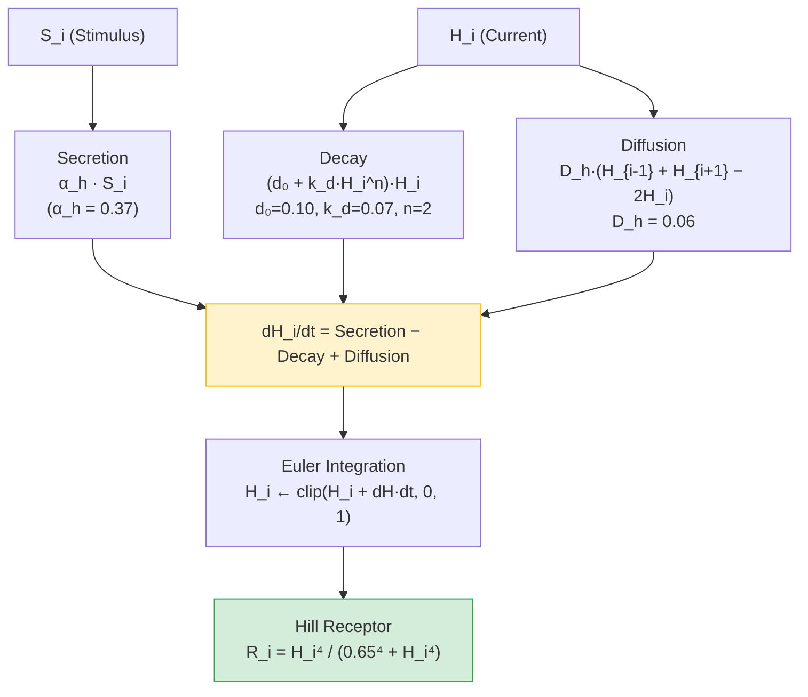
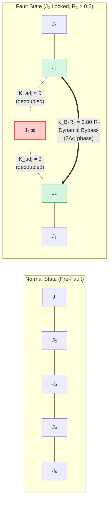
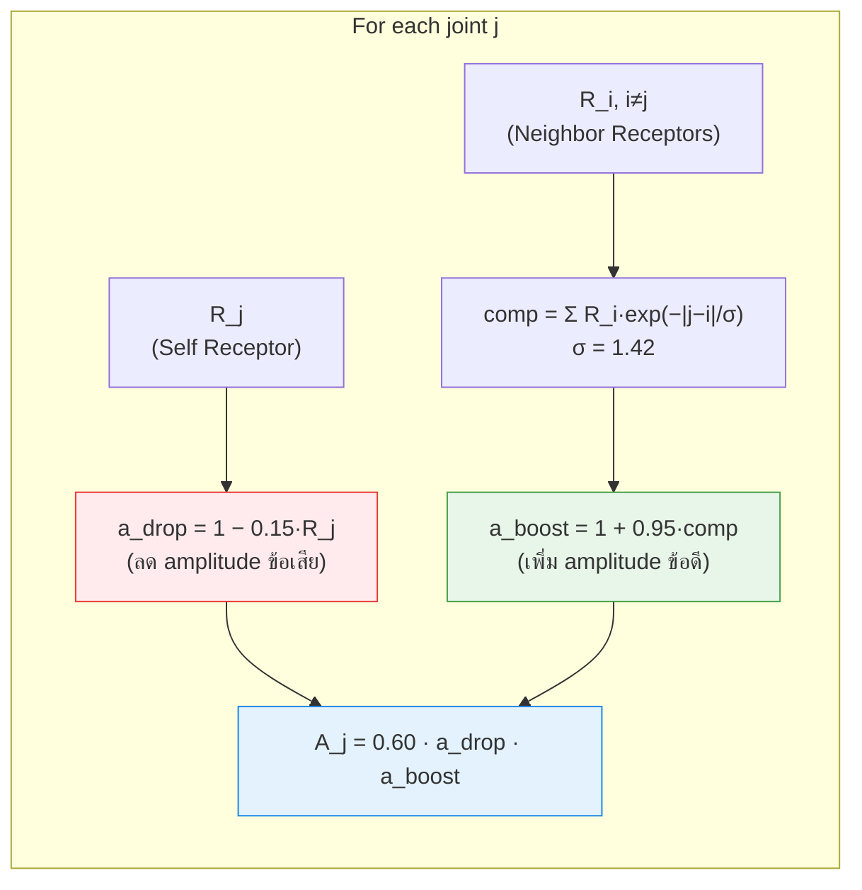
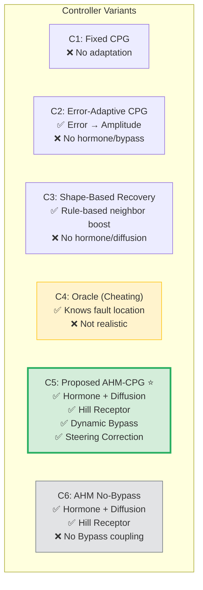

# C5: Proposed Local-Global AHM-Gated SO(2) CPG Controller — Architecture Diagram

## System Overview

```mermaid
graph TB
    subgraph ENV["🐍 Snake Robot Environment (PyBullet)"]
        ROBOT["Snake Robot<br/>9 Segments / 8 Joints<br/>PD Control: Kp=45, Kd=0.44"]
    end

    subgraph C5["Controller C5: AHM-CPG (100 Hz Control Loop)"]
        direction TB

        subgraph STEP1["① Sensory Feedback Acquisition"]
            FB["Sensory Feedback<br/>q_act, v_act, τ_act, τ_cmd"]
        end

        subgraph STEP2["② Hormone Engine (AHM)"]
            direction TB
            STIM["Stimulus Computation S_i<br/>Cycle-Averaged Mismatch"]
            ODE["Hormone ODE Integration<br/>dH_i/dt = αS_i − (d₀+k_d·H_i^n)H_i + D_h·∇²H_i"]
            HILL["Hill Receptor Activation<br/>R_i = H_i^m / (K_h^m + H_i^m)"]
            HG["Global Hormone<br/>H_G = mean(H)"]
            STIM --> ODE --> HILL
            ODE --> HG
        end

        subgraph STEP3["③ Amplitude Modulation"]
            AMP["A_j = A₀ · (1 − g_a·R_j) · (1 + g_n·Σ comp)"]
        end

        subgraph STEP4["④ Frequency Modulation"]
            FREQ["ω_scale = 1 − g_w·H_G"]
        end

        subgraph STEP5["⑤ Topology Reconfiguration"]
            COUP["Normal Coupling<br/>K_adj = K₀·(1 − max(R_i, R_{i+1}))"]
            BYP["Dynamic Bypass Matrix<br/>K_B(i−1,i+1) = K_B·R_i<br/>when R_i > 0.2"]
        end

        subgraph STEP6["⑥ SO(2) CPG Network"]
            CPG["SO(2) Limit-Cycle Oscillators<br/>dx₁/dt = −ω·x₂ + α(1−r²)x₁ + coupling<br/>dx₂/dt = +ω·x₁ + α(1−r²)x₂ + coupling"]
        end

        subgraph STEP7["⑦ Steering Correction"]
            STEER["Heading Bias Receptor<br/>Yaw offset = −γ·Σ R_steer"]
        end

        FB --> STIM
        HILL --> STEP3
        HILL --> STEP5
        HG --> STEP4
        STEP3 --> STEP6
        STEP4 --> STEP6
        STEP5 --> STEP6
        STEP6 --> STEER
    end

    ROBOT -- "joint_angles, velocities,<br/>torques feedback" --> FB
    STEER -- "q_d target angles" --> ROBOT

    style C5 fill:#f0f8ff,stroke:#2980b9,stroke-width:2px
    style ENV fill:#fdf6e3,stroke:#b58900,stroke-width:2px
    style STEP2 fill:#fef9e7,stroke:#f39c12,stroke-width:1px
    style STEP6 fill:#eaf7ea,stroke:#27ae60,stroke-width:1px
```

---

## Detailed Data Flow (Per Step)

```mermaid
flowchart LR
    subgraph INPUT["Sensory Input"]
        A1["q_target<br/>(last step)"]
        A2["q_actual"]
        A3["v_actual"]
        A4["τ_cmd"]
        A5["τ_actual"]
    end

    subgraph MISMATCH["Mismatch Errors"]
        B1["e_q = |q_d − q_act|"]
        B2["e_v = |v_act|"]
        B3["e_τ = |τ_cmd − τ_act| / τ_max"]
        B4["P_mech = |τ·v| / (τ_max·v_max)"]
    end

    subgraph BUFFER["Cycle-Averaged Buffers<br/>(W ≈ 67 steps)"]
        C1["ē_q, ē_v, ē_τ, P̄"]
    end

    subgraph STIM_CALC["Stimulus S_i"]
        D1["S_i = 0.44·ē_q + 0.03·ē_v<br/>+ 0.44·ē_τ + 0.10·P̄"]
    end

    INPUT --> MISMATCH --> BUFFER --> STIM_CALC

    style INPUT fill:#e8f4f8,stroke:#3498db
    style STIM_CALC fill:#fef3e2,stroke:#e67e22
```

---

## Hormone Dynamics ODE

---

## CPG Topology Reconfiguration (Bypass Mechanism)

---

## Amplitude Modulation Detail

---

## Complete 7-Step Pipeline Summary

| Step | Module | Function | Key Parameters |
|:---:|:---:|:---|:---|
| ① | Sensory Feedback | รับค่า q, v, τ จาก Robot | 8 joints × 4 signals |
| ② | Hormone Engine | คำนวณ Stimulus → Hormone ODE → Hill Receptor | α=0.37, D_h=0.06, m=4, K_h=0.65 |
| ③ | Amplitude Mod | ลด A ข้อเสีย + เพิ่ม A ข้อข้างเคียง | g_a=0.15, g_n=0.95, σ=1.42 |
| ④ | Frequency Mod | ลด ω ทั้งระบบตาม H_G | g_w=0.15 |
| ⑤ | Topology Reconfig | ตัด coupling ข้อเสีย + สร้าง Bypass | K_B=2.80, threshold=0.2 |
| ⑥ | SO(2) CPG | Integrate limit-cycle oscillators | ω=2π, α=2.5, K₀=1.20 |
| ⑦ | Steering Correction | ชดเชย yaw drift ผ่าน R_steer | γ=−0.18 |

---

## Controller Comparison (C1–C6)

---

## Key Mathematical Equations

### Stimulus Calculation
$$S_i = 0.44 \cdot \bar{e}_q + 0.03 \cdot \bar{e}_v + 0.44 \cdot \bar{e}_\tau + 0.10 \cdot \bar{P}$$

### Hormone ODE
$$\frac{dH_i}{dt} = \alpha_h S_i - (d_0 + k_d H_i^n) H_i + D_h (H_{i-1} + H_{i+1} - 2H_i)$$

### Hill Receptor Activation
$$R_i = \frac{H_i^m}{K_h^m + H_i^m}, \quad m=4, \; K_h=0.65$$

### Amplitude Modulation
$$A_j = A_0 \cdot \underbrace{(1 - g_a R_j)}_{\text{drop}} \cdot \underbrace{\left(1 + g_n \sum_{i \neq j} R_i \cdot e^{-|j-i|/\sigma}\right)}_{\text{neighbor boost}}$$

### Frequency Modulation
$$\omega_{\text{scaled}} = \omega_0 \cdot (1 - g_w \cdot H_G)$$

### SO(2) Limit-Cycle Oscillator
$$\dot{x}_1 = -\omega x_2 + \alpha(1-r^2)x_1 + \text{coupling}$$
$$\dot{x}_2 = +\omega x_1 + \alpha(1-r^2)x_2 + \text{coupling}$$

### Target Joint Angles
$$q_{d,i} = A_i \cdot x_{i,1} + b_i$$
